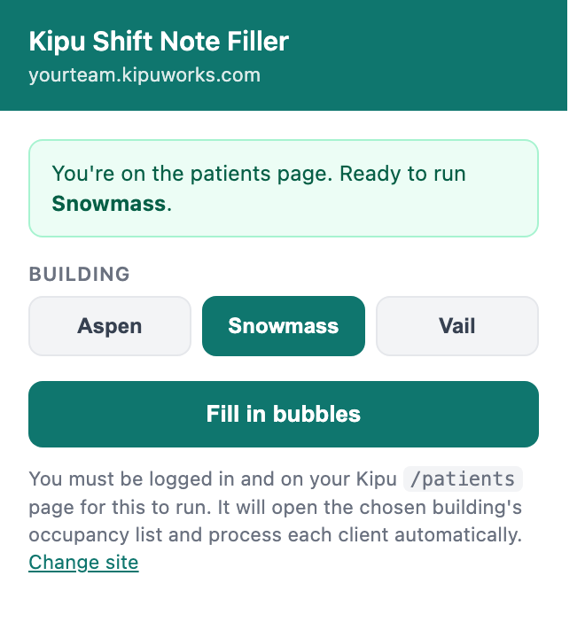

# Kipu Shift Note Filler

A Chrome extension that auto-fills a standard shift note for every client in a
chosen building on a Kipu occupancy board.

Point it at your Kipu site, pick **Aspen**, **Snowmass**, or **Vail**, click
**Fill in bubbles**, and it walks the building's client list one at a time —
opening each chart, creating a new shift note, checking the standard boxes, and
submitting.



## Install

1. Open `chrome://extensions`.
2. Turn on **Developer mode** (top-right).
3. Click **Load unpacked** and select the `kipu-shift-note-extension` folder
   (the folder itself, not the `.zip`).
4. Pin the extension so it's visible in the toolbar.

After pulling new changes, click the reload arrow on the extension's card so
Chrome picks them up.

## Usage

1. Click the extension icon and enter your Kipu site, for example
   `yourteam.kipuworks.com`. It's saved locally in `chrome.storage` and only
   asked for once — use **Change site** to update it later.
2. Log in to Kipu and go to that site's `/patients` page. The start button is
   disabled anywhere else, which is how it confirms you're logged in.
3. Click the extension icon, choose a building, then click **Fill in bubbles**.
   Your building choice is remembered for next time.
4. Leave the tab open and focused. The popup shows progress (`Client X of Y`),
   and **Stop** halts the run at any point.

## How it works

The popup opens `/occupancy?p_building=<id>` on your configured site, then the
content script takes over and runs as a small state machine, persisting its
phase to `chrome.storage.local` so it survives the page loads between steps.

**Picking the right list.** Before reading any clients, it waits for the
occupancy sub-nav to render and checks which tab carries the `active` class. If
Kipu ignored the URL parameter and opened a different building, it clicks the
correct tab. Those tabs are `data-remote` links that swap the bed table over
AJAX rather than reloading, so it waits for either the active tab to move or
`#assigned_beds` to be replaced before scraping. If it can't confirm the right
list is on screen, it stops rather than filling notes for the wrong unit.

**Finding clients.** Patient IDs come from the `/patients/{id}` links in the bed
table, so names and ordering don't matter. The board hydrates rows
progressively, so it waits for the count to hold steady across several polls
before locking in the queue.

**Filling the form.** For each client it opens Shift Notes, clicks **Add form**,
creates a **New Shift Note**, and fills it from the profile for the building
you picked. Shared fields, then the two that differ:

| Field | All buildings |
| --- | --- |
| ADLS | Bathing, Grooming, Neat, Clean |
| Appetite | Within Normal Limits |
| Behavior | Cooperative, Restless |
| Thinking | Black & White Thinking, Negativity |
| Eye Contact | Appropriate |
| Affect | Appropriate |
| Mood | Euthymic, Anxious |
| Speech | Appropriate |
| Orientation | Time, Person, Place, and Situation |
| Insight | Good |
| Risk Thoughts/Behaviors | None Reported |
| Additional Info about Risk Thoughts/Behaviors | None |
| Current Craving Level | 8 |

| Field | Aspen / Vail | Snowmass |
| --- | --- | --- |
| Withdrawal and Detox Symptoms | None | Cravings, Lack of Energy |
| PAW Symptoms | Cravings, Lack of Energy | None |

Options are matched by **section title + option label text** rather than element
IDs, since Kipu regenerates IDs on every page load. The date field is a jQuery
datepicker that Kipu may clear asynchronously, so it's re-applied right up
through the submit click. The form posts over AJAX, so the script waits for the
request to finish before navigating to the next client.

## Configuration

Nothing about a specific organization is baked into this repo. The Kipu host
lives only in your local `chrome.storage`, and the content script derives its
base URL from `window.location.origin`, so it works against whatever instance
you're signed in to.

The manifest grants access to `https://*.kipuworks.com/*`, and the popup
validates that the site you enter ends in `.kipuworks.com`. For an instance on a
custom domain, add it to `host_permissions` and `content_scripts.matches` in
`manifest.json` and relax `HOST_SUFFIX` in `popup.js`.

Building names and their `p_building` ids (Aspen `6`, Snowmass `7`, Vail `8`)
are defined in one place — `BUILDINGS` in `popup.js`. The per-building
checkbox profiles live in `PROFILE_BY_BUILDING` in `content.js`.

## Project layout

```
kipu-shift-note-extension/   the extension (load this folder unpacked)
  manifest.json              MV3 manifest
  popup.html / popup.js      site setup, building picker, start/stop, progress
  content.js                 the automation state machine
  icons/
kipu-shift-note-extension.zip   packaged build for the Chrome Web Store
docs/                           images used by this README
```

## Troubleshooting

- Open DevTools on the Kipu page and filter the console for `[KipuShiftNote]`.
  It logs the building switch, the clients it found, and any section or option
  it couldn't match.
- If you navigate away mid-run the loop pauses; starting again restarts from the
  top of the occupancy list.
- If Kipu renames a section title or option label, update the matching string in
  `PROFILE_BY_BUILDING` in `content.js`.

## Note on patient data

This repo contains no patient data and no organization-identifying details, and
it shouldn't gain any. The extension reads patient IDs from the page at runtime
and never stores or transmits them — the only things written to
`chrome.storage` are your Kipu host, the selected building, and run progress.
Avoid committing real screenshots of an occupancy board, since those capture
names, MRNs, and admission dates.
